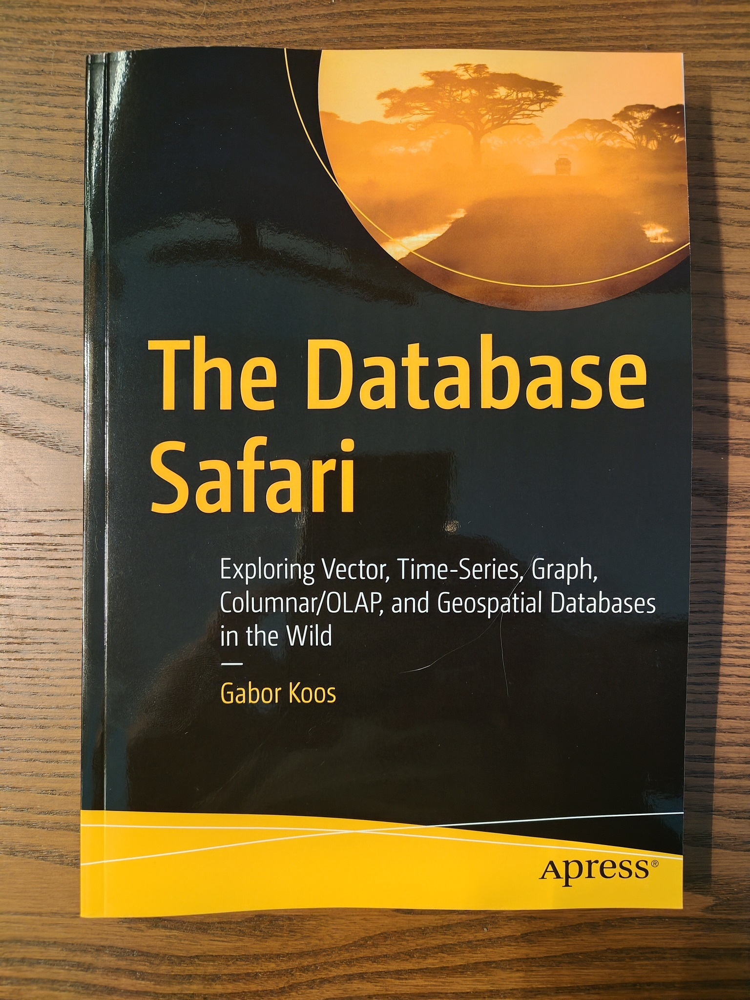

After months of research, writing, and collaboration, I'm thrilled to announce that my first book, <em>The Database Safari</em> is now available. It's been an incredible journey bringing this project to life, and I can't wait for readers to explore the wild world of these specialized databases and hybrid data architectures.

You can order your copy (ebook or print) on [Amazon](https://www.amazon.com/Database-Safari-Exploring-Time%E2%80%91-Geospatial/dp/B0GQKYF29M) or on [Springer Nature](https://link.springer.com/book/10.1007/979-8-8688-2709-9). On Springer, use the code `APAUT` for a 20% discount.

Happy reading!