TLDR: *I built a five-in-a-row engine using Rust, WebAssembly, and bitboards, and it was a wild ride. Play against it [here](https://gaborkoos.com/slap5/) or check out the source code [here](https://github.com/gkoos/slap5).*

In my youth, I used to play five-in-a-row a lot. We played at home and at school, during class, during breaks. Later, at some point, I was seriously interested in building my own chess engine, so I was familiar with the concepts of game trees, evaluation functions, and search algorithms. With this background, I thought solving five-in-a-row would be a nice little weekend project.

Two weeks and countless late nights later, I can proudly say that I have a working engine, but it's been a helluva ride. This article is a cautionary tale of what happens when ambition and overconfidence meet inexperience. As the classic [Warlords 3](https://www.scribd.com/document/48179684/Warlords-Battlecry-III-Manual-English) saying goes, "Enthusiasm without ability can take you precisely this far".

## The Beginning of the Journey

I knew what I wanted: [alpha-beta pruning](https://en.wikipedia.org/wiki/Alpha%E2%80%93beta_pruning), [iterative deepening](https://en.wikipedia.org/wiki/Iterative_deepening), and a simple [evaluation function](https://en.wikipedia.org/wiki/Evaluation_function). Adding [threat detection](https://www.baeldung.com/cs/gomoku-threat-space-search) and pattern recognition.

Originally I planned to use JavaScript because I wanted it to run in the browser. Then WebAssembly seemed like a good idea for better performance, so I went with Rust. My moderate experience with the language did not scare me off, and my good friends Dunning and Kruger reassured me that overconfidence would carry me through.

When I was contemplating writing a chess engine, I did some research and explored [bitboards](https://www.chessprogramming.org/Bitboards) as a way to efficiently represent the game state. They let you manipulate the board using bitwise operations, which can speed up the search and evaluation. My reasoning was that I wanted performance and I knew about bitboards, at least in the sense that I had heard of them, so I might as well use them.

This was the first time I bit off more than I could chew, but not the last. I had chosen Rust, WebAssembly, and bitboards without any prior experience in combining them effectively, and the challenges quickly piled up.

## Damn Bitboards

Well, it's 2026, and we have this thing called AI, I thought, so maybe I could just slopcode my way through the bitboard complexity. LLMs are great at scaffolding a project and using basic data structures, so I figured they could help me implement the bitboard logic without having to go into the deep details myself. And it went surprisingly well at first, with the setup I wanted ready in no time.

Then I did a little research and realised that the representation I (and Claude) had chosen deserved a closer look, given the patterns and threats I would need to detect. So with the help of the AI, I benchmarked different approaches and adjusted the implementation accordingly.

I compared storing the bits in four 64-bit integers with using two 128-bit integers. The latter was slower on every operation we measured. We also tried keeping separate boards for the four line directions, so rows and diagonals could each be processed in their own layout. That lost to a version using [AVX2](https://en.wikipedia.org/wiki/Advanced_Vector_Extensions), which lets the CPU do the bitwise work on 256 bits at a time. On the test for finding all the cells where a stone would complete five in a row, the directional boards were about 1.9 times slower.

The layout I settled on uses one 256-bit board per player for a 15-by-15 playing area. Each bit says whether that player has a stone on a particular cell. There are 15 playable cells in each row, followed by one unused bit that stays empty, so the bit index of a cell is `row * 16 + column`. That padding stops a line running off the right edge from continuing on the next row when checking for connected stones. Alongside the two stone boards, I keep a mask of the valid cells and a 64-bit hash identifying the position. Placing or removing a stone updates its bit and the hash.

On my machine, the AVX2 version was about three times faster than the four-integer version at detecting a win, and about four times faster at finding five-completion cells across the board. Making and undoing moves was slightly slower, so the advantage depended on what I was measuring. These were synthetic positions on one machine, but they gave me a reason to keep AVX2 where available. WebAssembly doesn't yet support AVX2, so the four 64-bit integers stayed as the fallback.

This was the easiest part, and it went quite well, but I was already falling behind my initial schedule. At that point, 2 days in, I only had a basic bitboard setup and vague ideas about how to use it to detect patterns and threats efficiently.

## Gomocup

I knew that once I had a more or less working engine, I was gonna spend most of my time testing it and tweaking parameters. Now, writing something that can beat me is not particularly challenging, so I needed a way to objectively evaluate its strength. I needed opponents I could test against repeatedly to see whether my changes were making it stronger.

Did some research and found [Gomocup](https://gomocup.org/), with plenty of engines available to download and compete against. Turned out they could play each other using an old app called [Piskvork](https://github.com/plastovicka/Piskvork), provided mine spoke its protocol. I wanted to spend my precious time on the game logic rather than dealing with the quirks of an outdated interface, so I turned to my AI friend to implement that part. I also downloaded a few opponents, along with some source code for inspiration.

I added a random move generator to the "codebase", and I had a working engine that could play against the others in Piskvork. It took three days instead of a few hours, and the boilerplate was predominantly AI slop, but the happy idiot in me was thrilled to see it actually working.

## Threats

The next milestone was to implement threat detection logic in the engine. I needed it to recognise the moves that would win immediately and the ones it had to block, and the bitboards made this very efficient and frustrating at the same time.

For each player, I computed threat masks from the two stone boards whenever they were needed. Each mask marks the empty cells where placing a stone would create a particular shape. I used six classes, strongest first: five, open four, four, open three, blocked three, and two. A bit in the five mask means I can win by playing there. An open four has a winning cell at either end, so blocking one still leaves the other available, and an open three threatens to become an open four on the following move.

Finding these shapes means checking windows along each of the four directions. With the padded layout from earlier, a step is a shift of 1 bit horizontally, 16 vertically, or 15 or 17 along a diagonal. By shifting copies of the boards and combining them, I can check the required stones and empty cells across many windows at once. A five-cell window is enough for a five or a four, while an open four needs six cells because both ends must be empty. The edge of the board counts as blocked.

At first, I combined the results from all four directions into one mask for each class. That was cheap and gave the forcing rules what they needed: the cells where I could win immediately, or where the opponent could win unless I blocked. For replies to a potential open four, I also collected the ends and the gap of each matching window. This includes some moves that do not actually stop the threat, so the search has extra candidates to check, but every real defence is included.

The combined masks lost something I needed for judging moves: a move that creates a horizontal four and a vertical four sets one bit in the four mask, exactly like a move that creates a single four. Both answers are correct, but the second threat has disappeared from the information available to the evaluation. Efficiently recognising a good move is of limited use if I then score it like a much less dangerous one.

So I added a representation called `Shapes`, which keeps the strongest class a move creates in each direction, for both players. An open four counts as an open four in that direction, without also being counted as an ordinary four, and two fours in different directions count twice. Move ordering and the evaluation use these classes, while the forcing rules keep using the combined masks. The weaker classes also help order moves, but the test for whether a move is "quiet" still only considers fives, fours, and open threes. Adding twos and blocked threes therefore changes the order in which moves are tried without changing which ones the search may skip.

I also left the search to decide whether a double three or a four-three actually wins. Those combinations depend on the opponent's replies, so recognising the shape alone was not enough to declare victory.

The individual masks were fast to compute. On a position with 30 stones using AVX2, finding five-completion cells took 54 nanoseconds and open-four cells took 59. Open threes and ordinary fours took 160 and 167 nanoseconds respectively. The engines whose source code I examined, [PentaZen](https://github.com/alien-wxr-xx/PentaZen) and [Rapfi](https://github.com/dhbloo/rapfi), maintain their threat information incrementally as moves are made and undone. I had not yet measured whether that approach would be cheaper in my engine once the full search was running.

With the per-direction classes used for evaluation and move ordering, the engine solved 19 of 21 test positions at one second per position, up from 18 with the combined masks. It still searched about 800,000 nodes per second, but needed roughly 20% fewer nodes at depth 8.

## Transposition Table

To speed up the search I didn't have yet, I implemented a [transposition table](https://en.wikipedia.org/wiki/Transposition_table), a cache that stores previously searched positions along with their scores and the depth at which they were searched. Different move orders can leave the same stones on the same cells, so separate branches of the search can end up doing exactly the same work. When that happens, the engine can reuse a sufficiently deep result from the table.

The key is based on the 64-bit hash I maintain alongside the bitboards, using a technique called [Zobrist hashing](https://en.wikipedia.org/wiki/Zobrist_hashing). Each combination of player and cell gets a fixed random number, and the position's hash is the XOR of the numbers for all the stones on the board. Placing a stone means XORing in its number, and undoing the move uses exactly the same operation, because XORing twice cancels it out. I also include the side to move in the table key, since whose turn it is changes the position the search has to evaluate.

I gave the table 32 MB, enough for roughly two million entries of 16 bytes each. Some bits of the key select a single slot, so different positions can compete for the same space. The entry also stores the full key, which I check before using it, so landing in an occupied slot does not mean I have found the same position.

Each entry records the best move and score, together with the search depth and a flag describing what the score establishes. Alpha-beta pruning can stop a search after establishing that a position is worth at least a certain score, without finding its exact value. Other results only establish an upper bound because none of the moves improved on the score the search needed to beat. The flag distinguishes those bounds from exact scores, and a bound is reused only when it is enough to settle the current search's comparison.

Depth matters because a result from looking two moves ahead cannot answer a question that needs six moves of analysis. I only reuse a score when the stored search reached at least the depth currently needed. A shallower entry can still supply a useful move to try first, which helps the search even when it has to work out the score again.

For replacement, I keep a deeper entry over a shallower one written during the same turn's search, while entries from an earlier turn can be overwritten. That keeps the memory use fixed without clearing the table between moves, and preserves the more expensive results while the current search is running.

## The Search

With threat detection working and all machinery in place, I could finally replace the random move generator with something that looked ahead and compared the positions it found. I used [negamax](https://en.wikipedia.org/wiki/Negamax) with alpha-beta pruning, evaluating positions from the point of view of the player whose turn it was and reversing the score when switching sides. Alpha-beta stops exploring a branch once a reply shows that it cannot improve on a move already available. This means the opponent only needs one good reply to ruin my plans, so checking all their other replies after finding it would be wasted work.

I added iterative deepening, repeating the search one ply deeper after each completed iteration, a ply being one player's move. If the deadline interrupts an iteration, I throw that iteration away and play the move from the last one that finished. This is a well known technique that works because the search tree grows exponentially with depth, so the deepest iteration accounts for most of the work and the earlier ones add relatively little overhead. Depth 1 is never interrupted, so there is always a move available. PentaZen makes use of partial results, while Rapfi also sticks to completed iterations, which was the approach I chose.

The ordinary move candidates are empty cells within two cells of an existing stone, with the centre played immediately on an empty board. To order them, I try the move from the transposition table first, then score candidates using the shape classes of both players. That gives me a reason to try a promising attack or an urgent defence before a move that merely extends a pair. I also give bonuses to two remembered cutoff moves at each ply, called killer moves, and use a history heuristic to reward moves that caused cutoffs elsewhere in the search.

This ordering matters because a good move found early lets alpha-beta discard more work. I added principal variation search on top: the first move gets a full search window, and later moves get a narrow test of whether they can beat the best score so far. A move that passes that test is searched again with the full window when needed.

The transposition table described earlier supplies both cached results and moves to try first. I check it before building the move scores, so a usable result also saves the work of ordering candidates I will never need to search.

I also borrowed PentaZen's move-count limits, allowing approximately `15 * sqrt(d) - 12` moves at remaining depth `d`, or `5 * sqrt(d) - 2` when a four or an open three is on the board. These are rounded and capped, so the search concentrates on fewer candidates in tactical positions. Quiet moves late in the ordering can be skipped or searched at reduced depth, with a full-depth search if a reduced move improves the score. I kept the move-count limit and the reductions behind separate switches, because discarding a branch and searching it less thoroughly have different consequences and needed measuring separately.

[Futility pruning](https://chessprogramming.org/Futility_Pruning) uses the static evaluation to skip quiet moves at shallow depth when the position is already far below the score it needs to reach. Its reverse form returns early when the position scores comfortably above the cutoff. This was a change that produced a measured gain in games, so it stayed on. I also kept null-move pruning: in a position without a forced reply, the engine temporarily passes and searches at reduced depth. If the position still scores above the cutoff after handing the opponent a free move, the search cuts that branch.

I implemented [razoring](https://chessprogramming.org/Razoring) too, but then left switched off because it cut shallow positions whose static score was already poor, including quiet positions where the loss was still two or three plies away. Internal iterative reduction, which searches a position shallower when there is no table move to guide the ordering, and a more elaborate table for late move reductions both finished level in games, so neither became part of the default search.

Forced replies needed different treatment from ordinary moves. Blocking a four or answering an open three costs no depth, allowing the main search to follow those chains instead of handing them to a separate search when the depth runs out. The free replies stop once the line reaches 64 plies from the root, and the deadline still applies throughout. A move that creates two threats gets an extra ply, giving the search more room to work through the replies to it.

Some positions are decided before checking whether the remaining depth has run out. If I can complete five, I have a win immediately available; if the opponent has two distinct winning cells and I have no immediate win, blocking one will not save me. An open four for my side also decides the position, provided the opponent cannot win first. These checks save the search from working through outcomes the threat masks already establish.

A win at ply `p` scores `30000 - p`, so the engine prefers a shorter win over a longer one. A reported mate then gets another search at its own mate distance, with the move-count pruning, reductions, and transposition table switched off. The check has its own limits, and a mate it cannot finish checking is explicitly reported as unverified.

The time management is fairly basic: take the turn allowance, cap it at a tenth of the remaining match time, and leave 50 milliseconds spare. The deadline is checked every 1,024 nodes, and no new iteration starts once half the budget has been spent. Every completed iteration also reports its move and score through a callback. That is what the browser's progress reporting and "Move now" button use, with the latter playing the move from the last completed iteration.

With the selective shortcuts and table disabled, the search is checked against plain minimax at depths 2 and 3. The positions decided by the threat rules are checked against minimax with the same end rules as well. For changes to the selective search, I measured each mechanism with it switched on and off, using the 21-position suite and match blocks of 100 games against engines with similar strength to judge what it actually bought me.

## The Evaluation

At the point where the search stopped looking ahead, I needed a number that said how good the resulting position was. My first evaluation function reused the threat masks, counting the set bits for each player and multiplying them by a weight for the corresponding class. The file header described it as a placeholder, with untuned weights and no positional terms, which was a fair assessment of how much thought had gone into it.

There were only four classes in that first version: five had a weight of 3,000, open four 1,500, four 300, and open three 100. A four therefore started with three times the weight of an open three, before I had done any tuning. I subtracted the opponent's weighted total from mine and clamped the raw difference to between -10,000 and +10,000. That limit kept the evaluation safely below the mate scores described earlier, but busy positions could hit the clamp and leave the search unable to distinguish between moves that would otherwise score differently.

The arithmetic had another problem: those bits represented the cells where a threat could be made, so several neighbouring cells could contribute to the score for the same threat. A single threat could be charged two to four times, and that accounting mistake survived for a very long time. The original version also inherited the loss of information between directions described earlier, so a move creating two fours got the same contribution from the four mask as one creating a single four.

With no values for blocked threes or twos, a lone centre stone scored zero. The evaluation had no way to reward the early development of a position before it produced one of the stronger threats. There was no preference for the centre and no tempo term to account for whose turn it was, either. I had given the search a way to compare immediate threats and left it very little to work with in positions where neither player had one yet.

For a while, reaching depth 0 also triggered a separate search for forcing sequences of fours, usually called VCF (Victory of Continuous Four). It could stop and take the static score instead of continuing an attack, and it had its own node and ply budgets. That routine rebuilt the threat masks at every node and worked outside the main search's transposition table and alpha-beta window. Once blocking a four became free in the main search, it could follow those chains itself, making the separate routine redundant, so I deleted it.

The tests checked that an empty board scored zero and that longer open lines scored higher, while blocking a line reduced its value. They also checked that changing the side being evaluated exactly negated the score, and that rotating or reflecting a position through all eight board symmetries left its value unchanged. With the original mask-based move ordering, this evaluation produced the 18/21 baseline mentioned earlier, at one second per position and search depths of 5 to 9.

## The Grind of Endless Tweaks

At this point, I had a working evaluation function that could distinguish immediate threats, but the engine still had very little sense of how to build a position. Make no mistake, even at this point it could beat the shit out of me, but against the downloaded engines it was still easily outmaneuvered in strategic play. So I rolled up my sleeves and started iterating, with the changes soon extending well beyond the evaluation function.

The test suite came from games the engine had lost to [Tito](https://gomocup.org/download-gomoku-ai/) and PentaZen. I took positions shortly before the end and used a separate, bounded threat search to identify moves that avoided the opponent's forced win. That gave me 21 positions I could test in about 25 seconds, instead of waiting for another batch of full games. A move passed when that threat search could no longer force a win within its limit, which left open the possibility of a longer winning sequence. All the positions were defensive, too, so the suite could tell me whether the engine had stopped making certain mistakes without telling me how well it attacked.

I compared features with their switches on and off, recording depth and node counts for each position at the same time limit. For changes intended only to make the code faster, I also used fixed-depth runs where the moves and scores had to stay identical. Full matches used the same openings with both colours and equal time per move, with unused openings held back from tuning. Initially those were small blocks against Tito and pela, and later I moved to 100-game pools because a handful of extra wins was proving far too easy to misinterpret.

First I rewrote the search, bringing in the separate search for fours and free replies to open threes, bounded by the 64-ply cap. I also added the selective limits described earlier. Alongside that, I moved tests into their own files and reduced the protocol module to dispatching commands, so I could work on the search without wading through unrelated code/AI slop.

The second attempt added the per-direction shape classes and made blocking a four free in the main search, which let me remove the separate leaf search. It also added an OpenAI audit that was considerably larger than the engine changes it was examining. The commit added more than 12,000 lines, about 10,400 of them in three JSON evidence files. There were two audit reports, backed by three Rust probes and three Python drivers, measuring individual mechanisms against the position suite and in matches. Most of the LLM findings were legit, it did a considerably better job at identifying gaps than at fixing them.

One result showed why I needed to test combinations of features. While the separate leaf search existed, making the four-blocking reply free scored 19/21, against 20/21 when it cost a ply. After removing the leaf search, the result reversed: the free reply scored 20/21, against 19/21 without it. The same idea looked harmful in one version and useful in another because I had changed the machinery around it. I had been paying for overlapping ways of following the same forcing sequences.

The audit also found that a supposedly verified mate had been checked with the transposition table still enabled. Roughly 119 of the check's 120 nodes returned through table cutoffs, so the verification was largely reading back the answer it was supposed to examine. Turning the table off made it search hundreds of thousands of additional nodes and still hit the deadline. That was why the verification described earlier needed both an independent search and an explicit way to report that it had failed to finish.

The matches were just as capable of producing encouraging results that fell apart on inspection. Extending a move that made two threats took the score against Tito from four wins to seven in a 20-game block. On fresh openings, the newer build then won three and drew one, while the control won five. I kept the extension as a sensible way to spend depth on a dangerous move, but withdrew the claim that it had demonstrated an improvement in playing strength.

My next commit deleted the audit reports and their supporting scripts, along with the raw evidence files, keeping the findings in the design-decisions document. It also moved the position suite into the examples directory and added the read-only iterator over set bits. What survived in the working tree was a shorter account of the conclusions and the code I had decided to keep.

Futility pruning arrived later that same day and produced the first measured gain in games from the search changes. Against Tito, it averaged 5.75 wins per 20-game block, compared with 3.67 with it switched off. Trying both milder and harsher margins made that result worse, so the original margin stayed. After all that work on following threats more carefully, a rule that discarded enough unpromising work to search elsewhere was the change that moved the match results.

Null-move pruning also stayed because it saved nodes where it applied without a measured loss in strength. The more elaborate reduction table and internal iterative reduction stayed off, as described earlier, and local speed improvements preserved the search results without producing a measured gain in games. By then I had also seen the same binary win anywhere from seven to fourteen games in successive 20-game blocks against KANEC. That was a useful reference whenever another small batch appeared to show that I had finally fixed the engine.

The next batch of evaluation changes started with fixing the repeated counting of the same threat. That made the scores smaller, which immediately affected the pruning rules because their margins had been chosen in the old score units. I had to adjust the overall scale and compare node counts at equal depth to keep those thresholds behaving roughly as before. Changing what a score meant was also changing which branches the search threw away, so even a correction to the arithmetic needed more than an evaluation test.

I then brought the four-to-open-three weight ratio down from 3:1 to 1:1, after examining positions where the static score disagreed with a deeper search. The old evaluation was overpricing fours and underpricing open threes. A small term for whose turn it was followed, based on a measured difference between the two colours. Against [KANEC](https://gomocup.org/download-gomoku-ai/), the 100-game pools went from 48 wins for the earlier build to 57 after the counting and ratio changes, then 59 with the tempo term. Those were encouraging results, but the variation between blocks gave me no reason to treat the last two extra wins as proof of anything, and agreement with my own search was still a limited way to judge an evaluation.

The LLM was great at running experiments and summarising the results, but it did a terrible job of explaining the deeper strategic reasons behind the engine's behaviour or suggesting meaningful improvements from them. Every attempt to give it a bit more autonomy ended up with superficial changes that did not address the core strategic deficiencies. It was even lying about the work it had done, claiming to have made improvements that were either trivial or nonexistent. Using it for analysis also required careful oversight and verification of its claims. It was enormously helpful for automating tedious tasks, but prompts like "make my engine 500 ELO stronger bro, no mistakes" wouldn't work.

## Engine Architecture

When the engine reached an estimated [1500ish ELO](https://gomocup.org/elo-ratings/#elo_3) against its test opponents, pela and KANEC, I stopped tinkering with it and started focusing on shipping it.

The native executable and the browser build use the same Rust search and board logic, with separate adapters for Piskvork and WebAssembly. In the diagram below, the arrows show which components each part calls or reads.

## Conclusion

The engine beats some of the weaker opponents and gets smashed by the stronger ones, but it definitely has some potential. Maybe next year I'll submit it to Gomocup. It's called **slap5**, and you can [play against it in your browser](https://gaborkoos.com/slap5/) or [look through the source code](https://github.com/gkoos/slap5).

I badly underestimated the work between having the algorithms implemented and understanding whether they were helping. Whenever I couldn't judge a proposed change myself, I was left running experiments without understanding what to change next, and the LLM's confident explanations were of little help. And never try to use AI for something that you couldn't do yourself, because it will come back and bite you later. The honest take is without AI I would have never started this project at all, but would have finished it somewhat quicker myself. Go figure.
